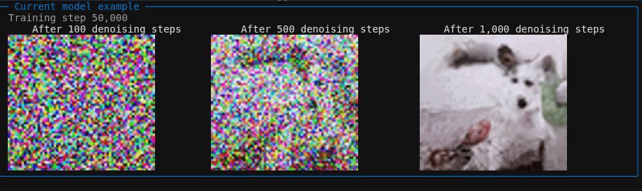

# Doggie Diffusion

A learning-first pixel-space diffusion model for generating random 64×64 RGB
dog images from scratch on a single RTX 2080. Training uses all 126,841 images
from the prepared dataset.

## Training example

Dashboard preview of the **block-level skip architecture at 50,000 training
steps**. The top row uses current weights; the bottom row uses EMA weights.
Both use seed `42` with identical generation randomness. Columns show results
after 100, 500, and 1,000 denoising steps.



## Prepare the dataset

The complete [SDIP dog dataset](https://huggingface.co/datasets/rmokady/SDIP_dog)
is downloaded at `/mnt/StorageBox/datasets/SDIP_dog`.

Full conversion completed successfully: **126,841 images across 32 shards**.
Every converted shard's image count matched its source.

From the repository root, run:

```bash
uv run scripts/prepare_dog_images.py /mnt/StorageBox/datasets/SDIP_dog
```

The script declares its own Pillow and PyArrow dependencies for uv. It reads
original `data/train-*.parquet` shards in bounded batches and writes matching
shards under `64x64/`, containing 64×64 RGB images encoded as lossless PNGs.
Images are EXIF-orientation corrected and resized with Lanczos filtering.
Original files are unchanged. Each completed shard is published only after its
row count matches the source. The command reports the final image count when
conversion completes.

The output directory must be empty. After an interrupted conversion, remove
only the generated `64x64/` directory before rerunning.

## Run training

From the repository root, with an NVIDIA GPU and CUDA available to PyTorch:

```bash
uv run doggie-diffusion
```

Press **S** to start or resume, **X** to stop, **G** to generate display-only
samples, and **Q** to stop and quit. During training, G queues generation after
the current update; while stopped, it generates from the saved checkpoint.
A checkpoint must exist for stopped generation. Repeated requests are
coalesced while waiting; only one generation runs at a time.
Training continues until stopped. A preview already in progress finishes
before shutdown; then the latest completed update is saved. Stopping does
not trigger an additional sample.
The shared dashboard restores the terminal's original input settings after
its run finishes, including when an exception unwinds the application.

Dashboard messages and full training-failure tracebacks are appended to
`logs/training.log`, relative to the working directory. Logs are git-ignored.

Model and training defaults live in
`src/doggie_diffusion/settings.py`. Preview and checkpoint intervals are
independent, both currently every 1,000 processed training batches.
The U-Net uses feature channels `(96, 192, 384, 384)`, with batch size 32,
in-process data loading (`loading_workers=0`), and AdamW at
learning rate 0.0002 with zero weight decay. Add loading subprocesses only
if measurements show data loading is a bottleneck. GPU memory use and
throughput have not yet been measured.

Each encoder residual block supplies a skip to a matching decoder residual
block. With two blocks at each of the 64×64, 32×32, and 16×16 levels, this
provides six skips. The decoder consumes them in reverse order, concatenating
each skip before its block. The 8×8 bottleneck retains two residual blocks.
See the [block-level skip decision](../../design-log/2026-11-12-doggie-diffusion-block-skips.md).

Four-head spatial self-attention follows the 16×16 residual stages in both
encoder and decoder and the 8×8 bottleneck. These levels have 384 channels,
with 96 features per head. Timestep conditioning applies a learned scale and
offset after normalization in every residual block.

The rolling checkpoint is
`trained-models/doggie-diffusion-dense-skips/checkpoint.pt`, relative to the
working directory. Resume restores model weights, optimizer state (including
its saved learning rate), scaler, EMA, and processed step count; data shuffling
starts anew. Reported metrics are stored in `metrics.sqlite3` alongside the
checkpoint. The dashboard restores the saved loss curve on open and trims
points beyond the checkpoint step on resume.

The denser-skip architecture starts fresh: previous checkpoints
under `trained-models/doggie-diffusion/` remain untouched and are incompatible
with the new decoder. Strict loading is retained; no weight migration is done.
Quit and reopen an already-running dashboard to load the new architecture.

Each preview displays current and EMA weights using identical generation
randomness with seed `42`, each showing 100, 500, and 1,000 denoising steps.
Dedicated CUDA generators avoid consuming training's random stream.
Generation remains synchronous: training pauses for both rows.

Only scheduled previews save the EMA row's final image as
`trained-models/doggie-diffusion-dense-skips/samples/generation-sample-{step}.png`,
where `{step}` is the processed training step. G-triggered previews are
display-only. If G coincides with a scheduled preview, the scheduled preview
satisfies it and retains its normal EMA-image save.
Sample saving is independent of checkpoint saves; historical checkpoints
are not retained. Repeating a scheduled training step overwrites its sample.

## Agreed training behavior

- Begin with 64×64 images; reduce resolution if iteration is too slow.
- Measure progress and run length in processed training batches, not epochs.
  FP16 overflow skips still advance the step count. Shuffle the training data.
- Load Parquet data in bounded portions and decode images as needed for
  batches; do not preload the complete dataset into RAM or GPU memory.
- Every 1,000 training steps, display current and EMA generations with matched
  randomness, each with snapshots after 100, 500, and 1,000 denoising steps,
  in the dashboard using textual-image.
- Keep save/resume simple, with git-ignored `trained-models/{model-name}/`
  storage. Deleting the model directory starts over.

The original discussion is recorded in
[the decision log](../../design-log/2026-11-10-doggy-diffusion.md), including
baseline architecture and checkpoint recommendations not yet agreed.
The project directory now uses the user's requested spelling `doggie-diffusion`;
the earlier decision log used `doggy-diffusion`.

The [full-dataset training decision](../../design-log/2026-11-11-doggie-diffusion-full-dataset.md)
supersedes the original 10,000-image subset plan and records step-based
training and dynamic loading requirements.

## Proposed network diagram

Open [the editable U-Net diagram](../../diagrams/doggie-diffusion-proposed-unet.tldraw)
in tldraw Offline. Page **01 · U-Net overview** aligns encoder and decoder
stages by resolution, with color-coded processing, skips, and timestep input.
Page **02 · Inside a residual block** expands the internal layers and routes
the residual shortcut around the processing path; a terminology guide follows.
The [network component decision](../../design-log/2026-11-11-doggie-diffusion-network-components.md)
records the agreed operations: SiLU, stride-2 convolutional downsampling,
nearest-neighbor resize followed by convolution for upsampling, and 1×1
shortcut projections when channel counts differ. Reusable component classes
use standard PyTorch layers and centralized settings. The
[implementation baseline](../../design-log/2026-11-11-doggie-diffusion-training-baseline.md)
records the subsequently approved defaults. The diagram remains a learning
aid rather than an automatically synchronized view of the code.
