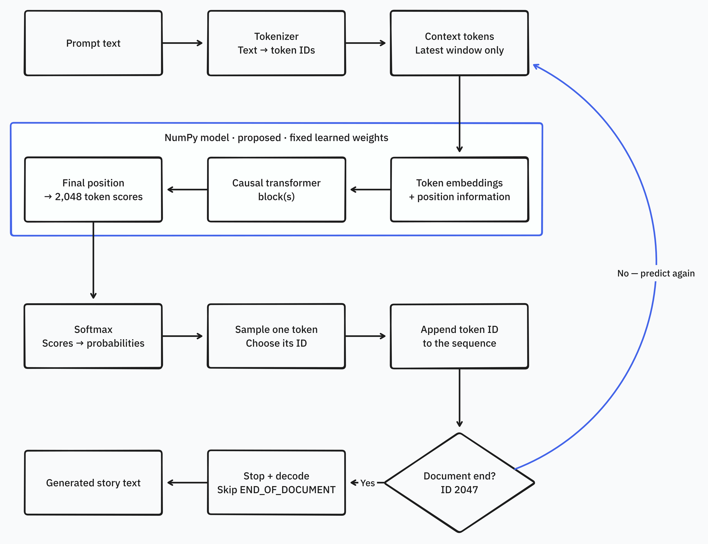

# NumPy LLM Stories

Build a small transformer that learns to generate children's stories, using
NumPy rather than PyTorch. The goal is to understand the underlying math by
implementing the forward calculations and deriving the gradients ourselves.

TinyStories gives us simple English and recurring story structures, making
progress recognizable: from common words and phrases toward short story-like
continuations. Coherent whole stories are a later milestone, not a promise for
the initial model.

## Current status

The shared tokenizer is trained. A Marimo lesson trains a single-block NumPy
decoder transformer on the first three complete real TinyStories training
stories, with causal attention, learned positions, and explicit backward
gradients. This is a session-local educational memorization experiment, not a
full-corpus model-training pipeline.

## Learning notebooks

### Interactive next-token predictor (Marimo)

From the repository root:

```bash
nix develop path:.
uv run --package numpy-llm-stories --extra marimo --extra notebooks marimo edit src/numpy-llm-stories/notebooks/03-next-token-predictor.py --host 127.0.0.1 --port 2718
```

Open the authenticated URL printed by Marimo. Run the pending cells using the
bottom-right run button if needed. The complete training stories are shown in
an accordion. Change epochs or learning rate to retrain from a fixed seed;
changing the prompt or generation limit does not retrain the model. Press Enter
or leave a text field to apply text edits.

The lesson uses 32 context tokens, width 32, one causal scaled dot-product
attention head, and a width-128 feedforward layer with tanh activation. Learned
position embeddings preserve order; pre-layernorm residual attention and
feedforward sublayers lead to a final layer normalization and a linear
vocabulary output at the last position. All gradients are computed manually in
NumPy, with Adam updates and minibatches of 16. Epochs range from 0–200 (default
80); the learning-rate slider ranges from 0.001–0.01 (default 0.003).

Each story is encoded as `[EOD] + story tokens + [EOD]`, where EOD is the
registered `<END_OF_DOCUMENT>` token. The initial EOD marks a fresh story
boundary. Every story token and the final EOD is a next-token target once per
epoch, including targets with short prefix contexts. Contexts contain at most
32 previous tokens and never cross story boundaries. Length-bucketed batches
need no padding; a supplied random generator reproducibly shuffles examples
within buckets and the order of batches.

The notebook opens with a transformer architecture diagram showing the complete
prediction path and both residual paths inside the decoder block.
[Editable diagram source](../../diagrams/numpy-llm-transformer-block.tldraw);
[full-size image](transformer-block.png).

The guided walkthrough shows token chips for the selected context, token and
position heatmaps, a causal attention heatmap, the final-position hidden
vector, and before/after prediction bars. Arrays are scrollable with explicit
position labels. Token-only and token-plus-position heatmaps share a signed
color scale; the final hidden vector has its own labeled scale. Probability
bars use a fixed 0–100% scale. Hover heatmap tiles for exact values and expand
the calculation panels to inspect the NumPy operations.

A live next-token prediction shows the highest-probability token and its
probability. A separate autoregressive greedy continuation repeatedly appends
the highest-probability token, using the latest context, until EOD or the
configured token cap (default and maximum 400). An empty prompt starts from
EOD. The training display reports loss per epoch, processed next-token
examples, and optimizer updates. Implementation cells remain collapsed but
available.

The user explicitly permitted this small fixed subset of complete training
stories for the educational notebook; the tokenizer still uses the full
training corpus. The corpus file and tokenizer artifact described below must
already exist locally. Weights remain in the notebook session, with no
checkpoints or full-corpus training pipeline promised. Memorizing these stories
does not demonstrate generalization or guarantee coherent new stories.
The `notebooks` extra is included alongside `marimo` to retain the existing
Jupyter tools in the shared environment.

### Earlier concept notebooks (Jupyter)

From the repository root, launch JupyterLab with this project's notebook tools.
On NixOS, first enter the repository's development shell so native dependencies
such as ZeroMQ can find the C++ runtime:

```bash
nix develop path:.
uv run --package numpy-llm-stories --extra notebooks jupyter lab --ServerApp.root_dir=. src/numpy-llm-stories/notebooks/00-environment.ipynb
```

uv installs the optional notebook dependencies into the shared workspace
environment. JupyterLab runs locally and prints an authenticated browser URL.
Choose **Python 3 (ipykernel)**; no global kernel registration is required.
Keep authentication enabled, and stop the server with **Ctrl+C** in its terminal
when finished.
The explicit server root keeps repository documentation links accessible, while
each notebook's kernel still starts in that notebook's directory.

Start with [00 · Environment](notebooks/00-environment.ipynb): inspect the Python
environment, a NumPy array, and our trained tokenizer. The tokenizer artifact
must already exist locally; see the shared tokenizer guide below if it is missing.
The kernel starts in the notebook's directory, which its artifact path assumes.

Continue with [01 · Token embeddings](notebooks/01-token-embeddings.ipynb):
encode a sentence, initialize an illustrative four-coordinate embedding table,
and select one row per token. These random vectors are not trained yet, and
the example does not choose the final model width.

[02 · Attention](notebooks/02-attention.ipynb) covers the query projection,
including a step-by-step calculation for one output coordinate, followed by
an interactive query–key comparison. Move sliders to explore how vector
direction and length affect dot-product scores.

Run cells in order. Use **Kernel → Restart Kernel and Run All Cells** to start
from a clean state. We will add concept-focused notebooks as we implement each
component, keeping explanations, calculations, and inspected outputs together.
Once a component is understood and reused, its implementation belongs in
`src/numpy_llm_stories/`. Long training runs will use scripts rather than depend
on notebook state.

## Inference overview



[Open the editable tldraw source](../../diagrams/numpy-llm-inference-overview.tldraw).

The model maps context tokens to **2,048 next-token scores**. Softmax converts
those scores into probabilities, and sampling chooses the next token. Append
that token to the sequence and repeat, using the latest tokens within the
context window, until `<END_OF_DOCUMENT>` is generated.

Learned weights stay fixed during inference. The tokenizer and generation loop
sit outside the model boundary. The interactive lesson implements the
single-block architecture described above and uses greedy decoding rather
than sampling; a bounded continuation need not form a complete story.

## NumPy model API

`src/numpy_llm_stories/transformer.py` exports
`Transformer(vocab_size, context_size=8, width=16, seed=42)`. Inputs are
padding-free token-ID batches of shape `(B, T)`, with `1 <= T <= context_size`;
the lesson constructs the model with `context_size=32, width=32` and trains on
all available prefix lengths through 32.

- `forward(ids)` returns a dictionary containing `probabilities` and `logits`
  of shape `(B, V)`, `attention` of shape `(B, T, T)`, and `token_embeddings`,
  `positioned_embeddings`, and `hidden` of shape `(B, T, D)`.
- `loss_and_gradients(ids, targets)` returns the scalar next-token loss and a
  dictionary of parameter gradients.
- `step(gradients, learning_rate)` applies Adam using internal moments and an
  update count. `parameters` holds the model's NumPy arrays.

Construct a separate instance with the same seed for the before-training
comparison; changing training controls starts from that fixed initialization.

## Dataset and tokenizer

We use **TinyStories V2**, with its existing training and validation splits:

```text
/mnt/StorageBox/datasets/TinyStories/
├── TinyStoriesV2-GPT4-train.txt
└── TinyStoriesV2-GPT4-valid.txt
```

The shared byte-level BPE tokenizer was trained on all **2,717,495 training
stories**, without validation text. The vocabulary contains:

- 256 base byte tokens, allowing unseen words to be represented.
- 1,791 learned merges.
- One control token, `<END_OF_DOCUMENT>`, with ID **2047**.

Dataset separator lines (`<|endoftext|>`) are excluded from tokenizer training
and story text. The notebook loads the first three complete nonempty training
stories, preserving their whitespace, and explicitly inserts the document-end
ID before and after each encoded story rather than encoding its spelling.
An unterminated final story counts at EOF; too few complete nonempty stories
is an error.

`src/numpy_llm_stories/stories.py` provides `load_stories(path, count=3)`,
`encode_stories(stories, tokenizer)`, and
`training_batches(sequences, context_size, batch_size, rng)`. The latter yields
padding-free `(contexts, targets)` arrays of shapes `(B, T)` and `(B,)`; call it
afresh for each epoch. Model construction and training orchestration remain
outside this data module.

The local tokenizer artifact is
`trained-models/tokenizers/simple-english.json`, relative to the repository root.
Generated artifacts and dataset files are not included in this model directory.

See the [shared tokenizer README](../../libs/model-tokenizer/README.md) for the
training command, API, and artifact details.

## Related documentation

- [Development setup](../../DEVELOMENT.md)
- [Inference architecture decision](../../design-log/2026-11-13-numpy-llm-inference-overview.md)
- [Dataset and vocabulary decision](../../design-log/2026-11-13-tinystories-tokenizer-training.md)
- [Single-block transformer decision](../../design-log/2026-11-15-single-block-transformer.md)
- [Complete-story notebook decision](../../design-log/2026-11-15-complete-story-notebook.md)
